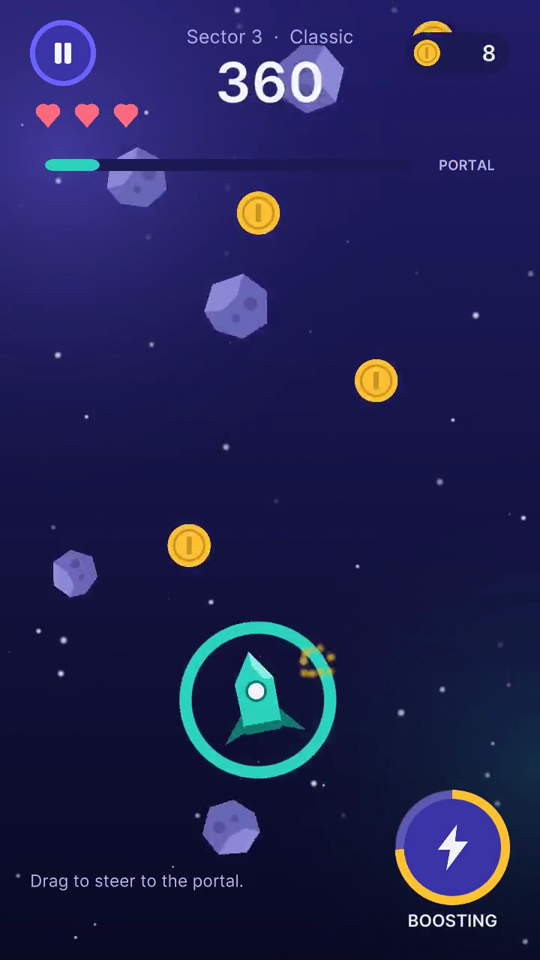
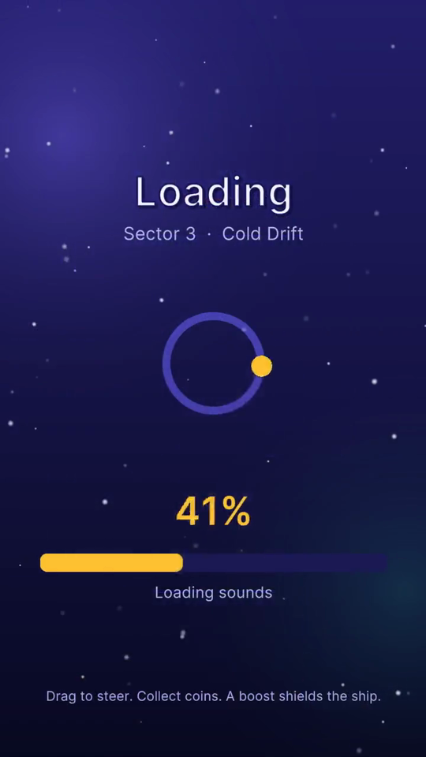
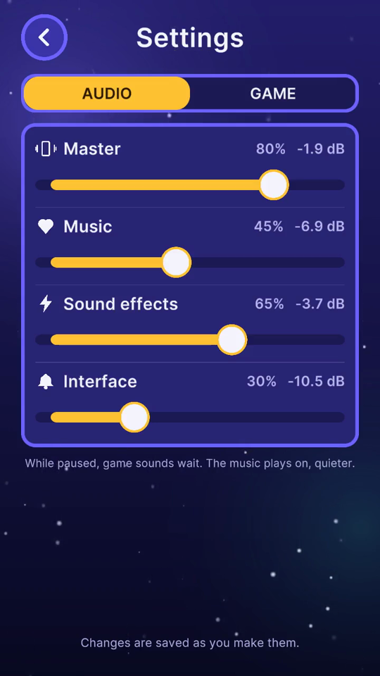
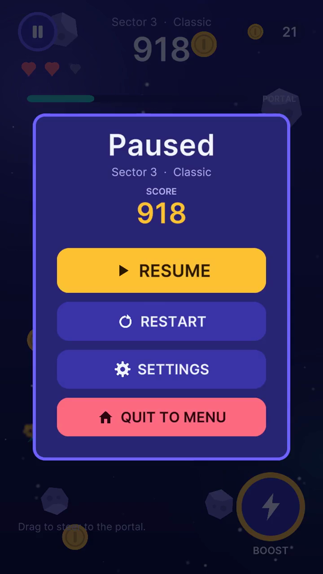
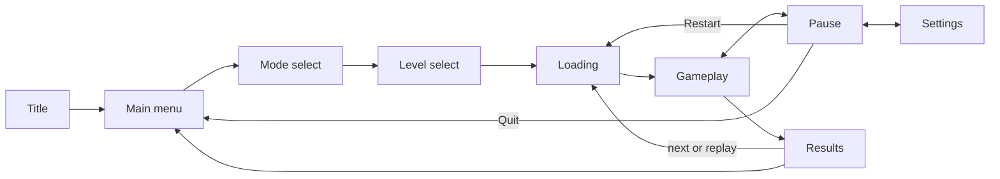
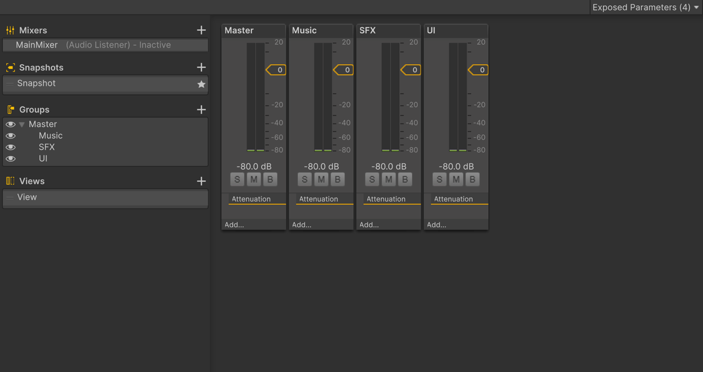

# ITU-CS-464-LAB-08-BSSE23040

CS-464 Game Development, Lab 08. My Lab 07 menu system turned into a small playable game with a real loading screen, sound, an Audio Mixer and C# events. By Mohsin Raza Ojla (BSSE23040).

- Demo video: https://drive.google.com/file/d/1YrMjyOypXsmtG67ofiOO6SaJvKLVcLJu/view?usp=sharing (about 3 minutes, with sound). The last part is recorded in a second Unity session, to show the saved volumes after a restart.
- Unity version: 6000.6.2f1. I only made and tested it in this one.
- Built on top of [Lab 07](https://github.com/bsse23040/ITU-CS-464-LAB-07-BSSE23040). The commit history of Lab 07 is kept, and the notes about the menu design are in its README.

The game is called Comet Dash. You steer a ship, dodge rocks, pick up coins and try to reach the portal.

## How to run it

1. Install Unity 6000.6.2f1 with Unity Hub. Use Add > Add project from disk and pick this folder. The first import takes a few minutes.
2. Open `Assets/Scenes/Menus.unity`. Always start from this scene. `Gameplay.unity` is loaded by the game on top of it and does nothing on its own.
3. In the Game view pick a portrait size (I used 1080 x 1920) and press Play. Check that "Mute Audio" is off in the Game view toolbar.

Controls: click or tap the menus. In a run, hold the mouse button (or your finger) and drag to steer. The round button at the bottom right is the boost. The top left button or Escape pauses.

How a run works: you have three hearts. A rock takes one. A green repair kit shows up when you are hurt and gives one back. A coin is 25 points and you also get 10 points a second. The boost shields the ship for 3 seconds, makes everything faster, doubles the points and then recharges. Classic reaches the portal after 30 seconds and Time Attack after 22. Endless has no portal.

| Gameplay | Loading | Audio settings | Pause |
|---|---|---|---|
|  |  |  |  |

## The full flow



All ten Lab 07 screens still work, with their slides, tweens and safe area layout. The loading screen is new.

## Loading

There are two scenes. `Menus.unity` stays loaded the whole time. `Gameplay.unity` is loaded additively on top of it before every run and unloaded when you leave the run. Every way into a run (Start, Next sector, Try again, Retry and Restart) goes through `LoadingScreen.cs`:

1. If an old Gameplay scene is still there, it is unloaded with `UnloadSceneAsync`.
2. The new one is loaded with `SceneManager.LoadSceneAsync(..., LoadSceneMode.Additive)` and `allowSceneActivation = false`. The first 70% of the bar is `AsyncOperation.progress`. That value stops at 0.9 while activation is held back, so it is divided by 0.9.
3. The scene is activated and the code waits for `isDone`.
4. The last 30% is real too. The gameplay sounds and the game music are imported with "Preload Audio Data" switched off, and the loading screen calls `LoadAudioData()` on them one by one and waits for each.
5. Only then does it open the game screen. The run starts when that screen is shown (`GameplayBridge`), never while loading.

The bar eases toward the real value and is never ahead of it. The screen stays for at least 0.9 seconds so it does not just flash by. Back does nothing on it, and transitions block taps, so you can't get into a half loaded level.

## Audio

### Mixer

`Assets/Audio/MainMixer.mixer` has four groups. Music, SFX and UI are children of Master.



| Group | Exposed parameter | AudioSources on it |
|---|---|---|
| Master | `MasterVolume` | none directly, everything goes through it |
| Music | `MusicVolume` | the two music sources of `MusicManager` |
| SFX | `SfxVolume` | the four voices and the preview source of `SfxPlayer` |
| UI | `UiVolume` | the one source of `UIAudio` |

That is eight AudioSources in total and every one has a mixer group. My test checks this.

### Volume mapping

Loudness is logarithmic, so a slider value is not sent to the mixer as it is. `VolumeSettings.cs` converts it:

```csharp
public static float ToDecibels(float slider)
{
    if (slider <= SilentBelow) return SilentDecibels;      // 0.0001 and below: -80 dB
    return Mathf.Log10(Mathf.Clamp01(slider)) * 20f;
}
```

| Slider | 100% | 80% | 50% | 25% | 10% | 0% |
|---|---|---|---|---|---|---|
| Mixer | 0 dB | -1.9 dB | -6.0 dB | -12.0 dB | -20.0 dB | -80 dB (muted) |

The log of 0 does not exist, which is why zero is handled on its own. The settings screen (Audio tab) shows both the percentage and the decibels.

Saving: the values go into `PlayerPrefs` (`volume_master`, `volume_music`, `volume_sfx`, `volume_ui`) and are written to disk when you leave the settings, when the app goes to the background and when it quits. `AudioBoot` puts them back on the mixer in `Start`, because a mixer value set in `Awake` can be overwritten while the mixer starts. The defaults are 100, 80, 100 and 80%. "Reset progress" does not touch them.

### Interface sounds

`UIAudio` is the only thing that plays interface sounds, with one AudioSource. No button has its own. Each button has a tiny `UiSound` script that tells `UIAudio` what happened.

| Sound | When |
|---|---|
| hover | the pointer moves over a button or it gets selected |
| click | a button is pressed |
| back | going back a screen |
| open and close | opening a screen or panel, and closing everything to start over (for example back to the main menu) |
| pause and resume | opening and leaving the pause menu |
| success | buying, equipping, claiming the gift, resetting progress |
| error | not enough coins, a locked mode or sector, pressing a disabled button |

The screens don't play success or error themselves. They call `UiFeedback.Success()` or `UiFeedback.Error()`, which raise events that `UIAudio` listens to.

### Gameplay sounds

`GameSfx` plays seven of them: coin, hit, heal, boost, death, win and lose. `SfxPlayer` takes turns between four AudioSources and uses `PlayOneShot`, so they can overlap. The ones that repeat get a small random pitch change (coin up to 9%, hit 8%, boost 4%) so they don't sound like a machine.

### Music

Three looping tracks and two AudioSources. To change track, `MusicManager` starts the new one on the free source and crossfades over 1.5 seconds. The two volumes follow sine and cosine (an equal power fade), so the middle does not dip.

| Where | Track |
|---|---|
| menus | `music_menu`, calm |
| loading | whatever was already playing |
| gameplay | `music_game`, faster |
| results | `music_results` |

### While paused

Pause sets `Time.timeScale = 0` and `AudioListener.pause = true`.

| Audio | While paused | Why |
|---|---|---|
| gameplay sounds | held, they carry on after Resume | they belong to the frozen game |
| music | keeps playing, ducked to 35% | silence feels broken, and you can still set the music volume |
| interface sounds | play normally | the pause menu has to click |
| SFX slider test sound | plays | so you can set the volume from the pause menu |

The music, UI and test sources have `ignoreListenerPause` on. The music stays ducked in the settings if you opened them from the pause menu.

## C# events

The gameplay is split into publishers, which keep the rules and numbers, and listeners, which react. A publisher does not know who is listening. All events are raised with `?.Invoke`. Listeners add themselves with `+=` in `OnEnable` and remove themselves with `-=` in `OnDisable`.

| Publisher | Event | Subscribers |
|---|---|---|
| `ShipHealth` | `Damaged(hearts, max)` | `RunHud`, `GameSfx`, `SparkBurst`, `ScreenShake`, `HitFlash` |
| `ShipHealth` | `Healed(hearts, max)` | `RunHud`, `GameSfx`, `SparkBurst`, `HitFlash` |
| `ShipHealth` | `Died` | `RunController`, `GameSfx`, `SparkBurst`, `ScreenShake` |
| `FallingField` | `Collected(kind, position)` | `RunController`, `GameSfx`, `SparkBurst` |
| `FallingField` | `Smashed(position)` | `GameSfx`, `SparkBurst` |
| `ShipBoost` | `BoostStarted(seconds)` | `GameSfx`, `SparkBurst` |
| `RunController` | `GameStarted` | `RunHud` |
| `RunController` | `ScoreChanged`, `CoinsChanged`, `ProgressChanged` | `RunHud` |
| `RunController` | `GameWon(score)` and `GameLost(score)` | `RunHud`, `GameSfx`, `RunOutcome` |
| `ScreenManager` | `ScreenChanged(from, to, kind)` | `UIAudio`, `MusicManager`, `GameplayBridge` |
| `UiFeedback` | `Succeeded`, `Failed` | `UIAudio` |

The independent listeners are the HUD (`RunHud`), sound (`GameSfx`), sparks (`SparkBurst`), camera shake (`ScreenShake`), the hit flash (`HitFlash`) and saving the result (`RunOutcome`).

Two notes. The game is drawn on a UI canvas, where a Particle System would be hidden behind it, so the sparks are a small pool of UI images. For the same reason the "camera" shake moves the play field and leaves the HUD still.

### Code excerpt

The publisher declares and raises the event (`ShipHealth.cs`):

```csharp
public event Action<int, int> Damaged;          // hearts left, most there can be

public bool TakeHit(int amount = 1)
{
    if (Current <= 0 || Shielded || Hurt) return false;
    Current = Mathf.Max(0, Current - amount);
    safeUntil = Time.time + safeSeconds;
    Damaged?.Invoke(Current, max);
    if (Current == 0) Died?.Invoke();
    return true;
}
```

A listener subscribes and unsubscribes (`HitFlash.cs`, `Healed` left out here):

```csharp
void OnEnable()
{
    health.Damaged += OnDamaged;
}

void OnDisable()
{
    health.Damaged -= OnDamaged;
}

void OnDamaged(int current, int max) { Show(hurt, 0.34f); }
```

`UiFeedback` has static events, so unsubscribing matters even more there: a static event would keep a destroyed listener alive.

## How I tested it

I wrote an editor script (not in the repo) that plays the game in play mode at 1080 x 1920, presses the real buttons and checks the result after each step. It covers the loading bar (never backwards, never ahead of the real progress, no run before it finishes), the events and how many listeners they have, switching a listener off and on, win, lose, restart and quit, the pause behaviour, every volume slider at 100, 50, 10 and 0% against the real mixer value, the routing of every AudioSource and the old menu features. A second run in a new Unity session checks that the saved volumes come back. All 101 checks pass and no errors were logged.

## Credits

- Music and sound effects: all 19 files in `Assets/Audio` are made by [`Docs/make_audio.py`](Docs/make_audio.py), a Python script written for this project that builds each sound from basic waves and noise. No samples, no downloaded audio, no AI audio generator and nothing from a commercial game, so there is no third party audio licence to list. Run `python Docs/make_audio.py` to make them again.
- Font: [Inter](https://github.com/rsms/inter) by Rasmus Andersson and the Inter Project Authors, SIL Open Font License 1.1. The license text is in `Assets/Fonts/Inter-LICENSE.txt`.
- Art: every sprite is drawn by my own code. No AI-generated images, downloaded art or asset store packages.
- Engine and packages: Unity 6000.6.2f1, the Universal Render Pipeline, uGUI and TextMesh Pro.
- Easing formulas from [easings.net](https://easings.net) (Robert Penner's equations).
- Inspiration only: the lobby and shop style of PUBG MOBILE and the one-thumb runner feel of Subway Surfers. No assets, audio or code from either game.

## Folders

```
Assets/Scenes             Menus.unity (start here) and Gameplay.unity
Assets/Scripts            screens, ScreenManager, LoadingScreen, saved data and widgets
Assets/Scripts/Audio      VolumeSettings, UIAudio, UiSound, MusicManager, SfxPlayer, AudioBoot
Assets/Scripts/Gameplay   publishers, listeners and GameplayBridge
Assets/Audio              MainMixer and the sound files
Assets/Art, Assets/Fonts  sprites and Inter
Docs                      screenshots and the audio script
```

## Git

I worked on the `development` branch, starting from the finished Lab 07, and merged it into `main` with a pull request.
